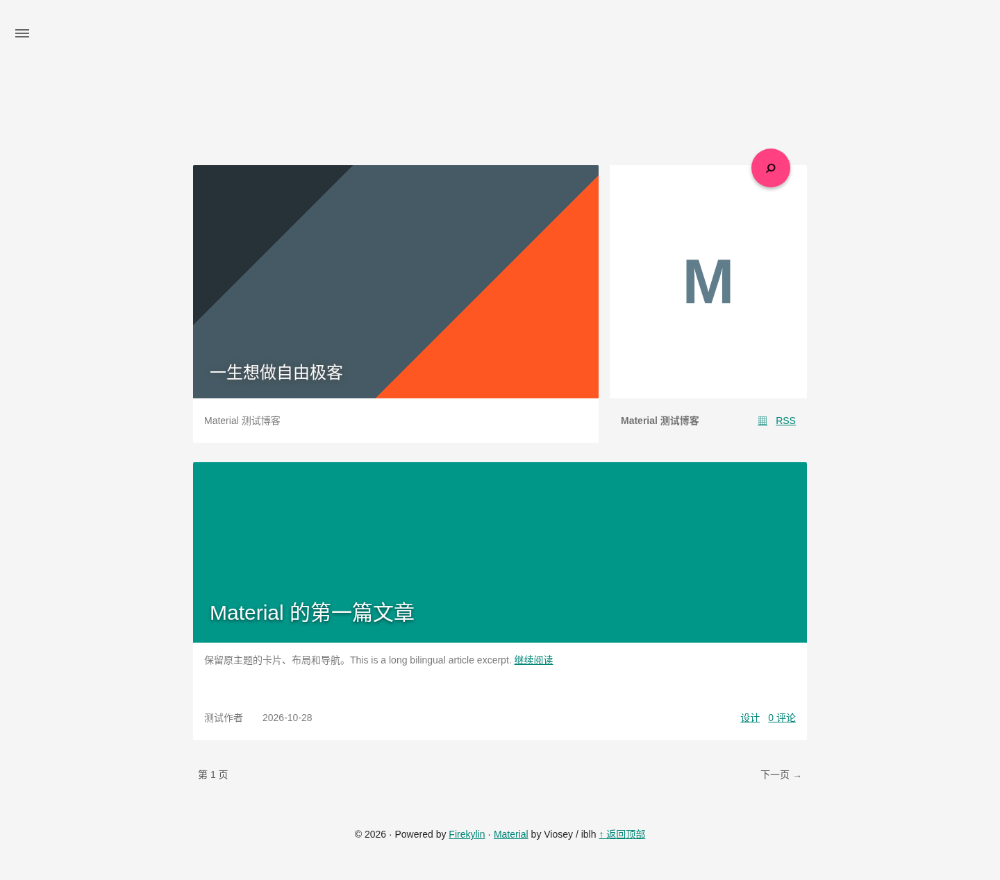
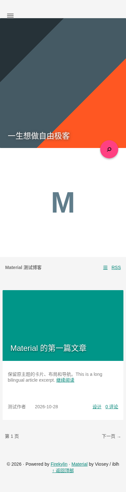

# Material draft verification

Core baseline: firekylin/firekylin `99bbdcb919bae2133420dee214c5f8897b9ace25`; theme source pin and unfinished work are documented in `packages/material/README.md`.

The render fixture uses the core's Eta dependency and real Archive/Contents Widget classes, supplying isolated fixture rows. It does not replace a database-backed site test. No production credentials or content are used. Install Playwright in an isolated tooling directory and use an installed Chromium executable.

```sh
FIREKYLIN_CHECKOUT=/path/to/firekylin node verification/material/render.cjs
# In another terminal, with playwright resolvable:
PLAYWRIGHT_MODULE=/path/to/tooling/node_modules/playwright CHROMIUM_PATH=/usr/bin/chromium node verification/material/browser.cjs
```

Use `THEME_PATH` to render an installed ZIP's theme directory. `EVIDENCE_DIR` overrides `/tmp/material-evidence`. The fixture server listens only on 127.0.0.1:8765.

Recorded local results: Node workspace checks 2/2; Python package/release unit tests 7/7; desktop 1440×1000 and mobile 390×844 fixture browser checks passed for home, post, page, archive and search, navigation opening/closing/Escape, search submission, zero JS/resource errors and no horizontal overflow. Category/tag checks are included in the final rerun. Screenshots use replacement artwork. Full upstream Typecho runtime comparison, live comment integration, real database routing and private-content checks remain outstanding.



